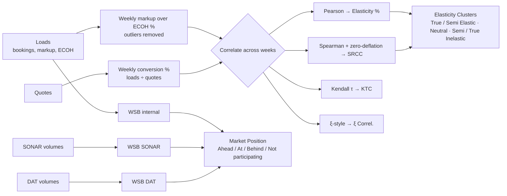

# Elasticity & WSB — Freight Price Elasticity in Power BI

A Power BI model that measures **how sensitive shippers are to price** on each truckload lane of a US freight brokerage, and places every lane against the wider market using a **Window / Shadow / Blind (WSB)** visibility framework.

The question behind it: *if we raise our markup on this lane, do we lose the load?* Lanes where conversion falls as markup rises are **elastic**, and price increases there cost volume. Lanes where conversion holds up are **inelastic**, and there is room to price up. Combining that with how visible the brokerage is on each lane compared with market benchmarks (SONAR and DAT) gives a per-lane pricing playbook.

> The data is a real, frozen snapshot (Jan 2022 – Jul 2024) with **all shipper and carrier identities replaced by fictional names**. See [Data & anonymization](#data--anonymization).

---

## What's inside

| Path | What it is |
|---|---|
| `Freight Elasticity.pbip` | Power BI Project — open this in Power BI Desktop |
| `Freight Elasticity.SemanticModel/` | The semantic model (`model.bim`): tables, relationships, 35 DAX measures, calculated tables |
| `Freight Elasticity.SemanticModel/DAXQueries/` | Four diagnostic DAX queries used to tune the outlier and zero-deflation fences |
| `Freight Elasticity.Report/` | The report: 16 pages |
| `Data/` | Parquet snapshots of every source table (≈ 6.5 M rows) |
| [`docs/methodology.md`](docs/methodology.md) | The maths behind every elasticity variant, cluster and WSB rule |
| [`docs/data-model.md`](docs/data-model.md) | Tables, keys and relationships |
| [`docs/report-pages.md`](docs/report-pages.md) | Page-by-page guide to the report |

## Quick start

1. Install [Power BI Desktop](https://powerbi.microsoft.com/desktop) (2.132 / Aug 2024 or later). If it can't open `.pbip` files, turn on *Options → Preview features → Power BI Project (.pbip) save option*.
2. Clone the repo to `C:\elasticity-wsb`:
   ```bash
   git clone https://github.com/kauemelo01/elasticity-wsb.git C:\elasticity-wsb
   ```
   If you clone it somewhere else, open *Transform data → Manage parameters* and point **`DataFolder`** at your `Data\` folder (keep the trailing backslash).
3. Open `Freight Elasticity.pbip` and click **Refresh**. The repo doesn't ship the data cache, so the model loads from `Data/` on first refresh.

---

## How the model works



### 1. Two weekly signals per lane

For every **week × lane** (by default at **KMA**, Key Market Area, level) the model computes two signals:

- **Markup over ECOH %**: markup ÷ the original *estimated cost of haul* (ECOH), the brokerage's estimate of what a carrier would be paid. Loads with ECOH under $300 are ignored, and outliers are removed with asymmetric percentile fences (P20 − 1.25·IPR, P80 + 1.75·IPR).
- **Conversion %**: booked loads ÷ quotes on the same week, lane, equipment and quoting method (manual vs. automated), capped at 100%.

### 2. Elasticity = correlation of markup and conversion over time

Elasticity is the **correlation between the two weekly series** inside whatever filter context a visual sets: a lane, a shipper, a region, a shipper × lane, and so on. A **negative** correlation means conversion falls when markup rises, so the lane is elastic. A lane is only scored when it has data in at least 10% of all weeks in the dataset (the *LPQ threshold*).

The model computes four variants of that correlation so you can compare them:

| Measure | Method | Why it exists |
|---|---|---|
| **Elasticity %** | Pearson *r*, squashed into (−0.46, 0.46) with a logistic transform | Baseline linear relationship |
| **Elasticity % SRCC** | Spearman rank correlation **minus a zero-deflation penalty** for weeks with missing markup or conversion | Robust to outliers and non-linear but monotonic responses; doesn't let thin lanes look confident |
| **Elasticity % KTC** | Kendall τ-a (concordant − discordant pairs ÷ all pairs) | Rank-based check that's less sensitive than Spearman to a few large rank gaps |
| **ξ Correl. %** | A variant of Chatterjee's ξ coefficient, logistic-normalised | Experimental: picks up non-monotonic dependence |

Full formulas and implementation notes: [docs/methodology.md](docs/methodology.md#3-elasticity-variants).

### 3. Elasticity clusters

Pearson and Spearman are combined into five segments, using a neutrality threshold equal to the median lane elasticity:

| Cluster | Rule |
|---|---|
| 1. True Elastic | both correlations negative |
| 2. Semi Elastic | Pearson negative, Spearman positive |
| 3. Neutral | both within ± threshold |
| 4. Semi Inelastic | Pearson positive, Spearman negative |
| 5. True Inelastic | both correlations positive |

A second segmentation, **Poisson Clusters**, runs Power BI's built-in k-means (k = 5) on Pearson elasticity, an externally fitted **Poisson-regression elasticity** and load volume. Comparing the two shows how well the correlation-based approach agrees with a regression-based one.

### 4. Window / Shadow / Blind and Market Position

WSB classifies how much visibility exists on a lane:

- **WINDOW**: high volume and many shippers. Rich data, so prices can be benchmarked.
- **SHADOW**: one of the two.
- **BLIND**: neither. Pricing is mostly guesswork.

It's computed three times: from the brokerage's own loads, from SONAR market volumes, and from DAT market volumes and contributor counts. **Market Position** then compares the brokerage's level with the market's: *Ahead of Market*, *At Market*, *Behind Market*, or *Not participating* (the market sees the lane and the brokerage doesn't). Rules: [docs/methodology.md](docs/methodology.md#5-window--shadow--blind-wsb).

### 5. The same model, many cuts

Because every measure is computed in filter context, the report reuses the same DAX at different grains. This is where the "variants" come from:

| Grain | Report page |
|---|---|
| City-to-city lane | *Lanes* |
| KMA lane | *KMAs*, *Clusterization [Lane KMA]* |
| Shipper | *Shippers*, *Clusterization [Shipper]* |
| Shipper × equipment × KMA lane (*Cluster Key*) | *Cluster Keys*, *Clusterization [Cluster Keys]* |
| Origin × destination region × distance bucket | *Regions* |
| Poisson lanes (130 dry-van KMA lanes) | *Clusterization [Poisson]* |

Conversion also has two variants, **Lane level** and **KMA level**, and all elasticity measures use the KMA one. Quoting method (manual vs. automated) is part of the matching key, so the two pricing channels are never mixed inside a single correlation.

---

## Data & anonymization

| Table | Rows | Content |
|---|---:|---|
| Loads (Main Set) | 111 k | Weekly booked spot FTL loads (dry van, flatbed, reefer), by shipper, carrier, lane, quoting method; bookings ≥ $300 |
| Quotes | 2.77 M | Weekly quote counts by lane, equipment, quoting method |
| dim_lane | 2.16 M | Lane dimension: city, state, region, KMA, average mileage |
| dim_carrier | 61 k | Carrier dimension: VIP flag, HQ region, fleet size, power units |
| Sonar Prices / Volumes | 1.29 M / 93 k | SONAR market rate and volume benchmarks by KMA lane |
| DAT Volumes | 9 k | DAT spot volumes and contributor counts by KMA lane |
| Poisson | 130 | Externally fitted Poisson-regression elasticities |

The data is a frozen snapshot covering **2022-W01 to 2024-W31**. The original warehouse, dataflow and spreadsheet connections were replaced with local Parquet files, so the project runs fully offline.

**Anonymization:**
- All **1,124 shipper names** were replaced with fictional ones ("Bashful Alpaca & Sons").
- All **59,681 carrier names** were replaced with fictional ones ("Stormy Burrito Carriers").
- **Carrier IDs and MC numbers** were replaced with random 9-digit numbers. Real MC and USDOT numbers have at most 8 digits, so a fake value can never point to a real carrier.
- The mapping was applied consistently across tables, so relationships and every measure behave exactly as on the original data.

## Tech notes

- Power BI Project format (PBIP) with a TMSL model (`model.bim`), compatibility level 1567.
- All logic is DAX: no Python/R visuals. The Poisson coefficients were fitted outside Power BI and imported as a table.
- Lane-level correlations are computed on the fly with `VALUES('Loads (Main Set)'[year-week])` as the observation set, so any slicer or filter changes the sample being correlated.
- Diagnostic DAX queries in `DAXQueries/` (`OL Fences`, `OL Counts`, `ZTD Fence`, `SRCC`) show how the outlier and zero-deflation fences were calibrated.
