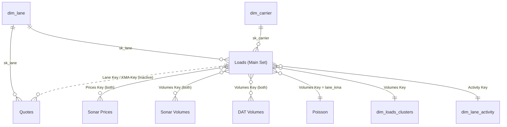

# Data model

A star-like model centred on **`Loads (Main Set)`**, with market benchmark tables attached through text keys built in calculated columns.



## Keys

The benchmark sources don't share surrogate keys with the brokerage data, so the model joins on **composite text keys** built as calculated columns:

| Key | Built as | Used to join |
|---|---|---|
| `Lane Key` | `year-week : lane : equip_type : quoting_method` | Quotes (city-lane conversion) |
| `KMA Key` | `year-week : lane_kma : equip_type : quoting_method` | Quotes (KMA conversion) |
| `Prices Key` | `year-week : lane_kma : equip_type` | Sonar Prices |
| `Volumes Key` | `lane_kma : equip_type` | Sonar Volumes, DAT Volumes, Poisson, dim_loads_clusters |
| `Activity Key` | `lane_kma : equip_type : quoting_method` | dim_lane_activity |
| `Cluster Key` | `shipper_name : equip_type : lane_kma` | the *Cluster Keys* analysis grain |

`lane` and `lane_kma` are pulled from `dim_lane` with `RELATED`. The KMA lane format is `ORIGIN_KMA -> DESTINATION_KMA`.

**Why the Quotes relationships are inactive:** the same table has to be joined at two grains, city lane and KMA lane. Both relationships are kept inactive, and each `# Quotes` measure switches on the one it needs with `USERELATIONSHIP`. This also avoids ambiguous filter paths through `dim_lane`.

**Why the market relationships are bidirectional:** filtering the report by a SONAR/DAT attribute, such as a WSB level, needs to narrow the brokerage's loads, and the reverse is needed as well.

## Tables

### Fact tables

**`Loads (Main Set)`**: one row per week × shipper × carrier × lane × equipment × quoting method. Scope: spot-market FTL loads, equipment DRV (dry van), FBE (flatbed) and RFR (reefer), non-cancelled, test and internal accounts excluded, rows with bookings ≥ $300, 2022-W01 to 2024-W31.

| Column | Description |
|---|---|
| `year`, `week`, `year-week` | ISO-style week of booking |
| `quoting_method` | `Manual` or `Automated` |
| `shipper_name`, `shipper_size`, `shipper_subgroup`, `sales_team` | shipper attributes (names are fictional) |
| `sk_lane`, `sk_carrier` | keys to `dim_lane`, `dim_carrier` |
| `equip_type` | DRV / FBE / RFR |
| `bookings` | revenue booked ($) |
| `mileage` | total miles |
| `loads` | number of loads |
| `Sourcing Spread Base` | gross sourcing spread ($) |
| `markup_ecoh`, `original_ecoh` | markup over, and value of, the estimated cost of haul ($) |

**`Quotes`** (hidden): weekly quote counts (`quotes`) by `sk_lane`, `equip_type`, `quoting_method`. Same scope filters as Loads.

### Dimensions

**`dim_lane`**: every lane in the lane master. City/state/region/country/KMA for origin and destination, `mileage_average`, `is_winnable_lane`, plus `lane_mileage_bucket` (under / over 500 miles).

**`dim_carrier`**: `carrier_name` (fictional), `mc` (fictional), `is_vip`, `hq_region_name`, `fleet_size`, `power_units`.

### Market benchmarks

| Table | Grain | Columns |
|---|---|---|
| `Sonar Prices` | week × KMA lane × rate type (`all` / `spot` / `contracted`) | `avg_rate`, `mileage` (confidence score > 7, rate ≥ $300, ≥ 50 rates) |
| `Sonar Volumes` | KMA lane × rate type | `volume` (number of distinct rates) |
| `DAT Volumes` | KMA lane × equipment (spot) | `volumes` (moves), `shippers` (contributor count) |

### External model output

**`Poisson`**: 130 DRV KMA lanes with a Poisson-regression markup elasticity (`elasticity`, × 100), plus `poisson_raw` and `Poisson Clusters`.

### Calculated tables

| Table | Purpose |
|---|---|
| `dim_loads_clusters` | Per `Volumes Key`, a snapshot of Market Position (SONAR and DAT), elasticity cluster and the three WSB levels, so they can be used as slicers |
| `dim_lane_activity` | Per `Activity Key`, whether the lane had loads in 2023 / 2024 |
| `ClusterMappingTable` (hidden) | k-means (k = 5) output behind `Poisson Clusters` |
| `DateTableTemplate_…` | Auto date/time template created by Power BI (unused) |

## Data refresh

Every source table is a Power Query that reads a Parquet file from the **`DataFolder`** parameter:

```m
let
    Source = Parquet.Document(File.Contents(DataFolder & "Quotes.parquet")),
    #"Changed Type" = Table.TransformColumnTypes(Source, {{"quoting_method", type text}, …})
in
    #"Changed Type"
```

The Parquet files are a frozen snapshot of the original warehouse, dataflow and spreadsheet extracts, with shipper and carrier identities anonymized (see the [README](../README.md#data--anonymization)).
